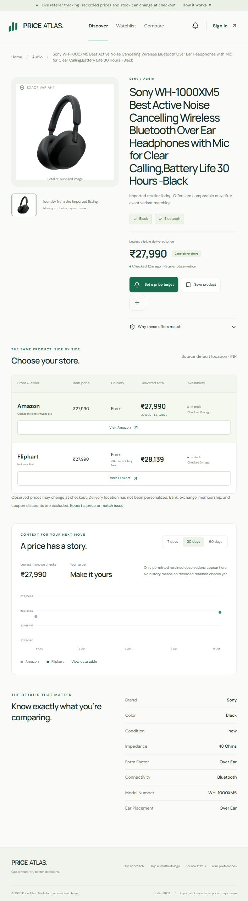

# Verification — 4 October 2026

- PostgreSQL and TCP Redis connectivity succeeded; Supabase Auth settings returned HTTP 200.
- Migration `001_live` applied to the dedicated `atlas` schema. Existing application schemas were not changed.
- Actual cloud RLS check verified owner-only reads and writes in a rolled-back diagnostic transaction.
- 106 Vitest tests passed: domain logic, SQLite demo, isolated PostgreSQL/RLS workflows, scraper selectors/structured data, quotas/recovery, source revocation, email tokens and Telegram linking/delivery/review.
- Final production build, TypeScript and repository formatting checks passed. The local production server and worker are running the final implementation.
- 10 live API smoke checks passed, including demo-session rejection, protected imports, private admin access, URL rejection and cross-origin writes.
- Amazon Sony listing and Flipkart Pixel listing were parsed and imported with real source IDs, images, timestamps and price components. No cross-store equivalence was claimed between these different products.
- A real scheduled run dispatched two jobs through Redis/BullMQ. Both completed and wrote two new PostgreSQL observations (`pipeline-check-1791129565036`).
- Resend accepted a sandbox message to its reserved `delivered@resend.dev` simulation address. This proves provider acceptance, not delivery to a user's inbox. Qualifying alert delivery and duplicate suppression were tested against an injected provider in the isolated database.
- Browser checks verified real product display, retailer purchase destinations, unknown shipping states, fee totals and the live sign-in/target controls. Full cross-browser Playwright and WCAG audits have not been executed for this update.
- The initial implementation was committed as `ded251f` and pushed to GitHub `main`. The user subsequently activated Vercel live mode: hosted `/api/v1/health` now reports live mode and a reachable database. All 10 live API smoke checks passed against the hosted app.
- Migration `002_telegram` is applied to the cloud database. The real bot's identity was verified during setup. Telegram linking and delivery are tested in isolation; actual cloud webhook registration and recipient delivery remain pending. See [Telegram setup](./TELEGRAM.md).
- The live catalog was checked at the normal browser size and at 390px width, with no horizontal page overflow. A preview is saved in `docs/previews/live-catalog.png`.

The user reports Supabase callbacks/Google OAuth, Redis eviction changes and a Render worker deployment are configured. Actual sign-in, continuous worker uptime, eligible source permissions, human recipient delivery, signed webhook registration and load/restore rehearsals remain unverified. The hosted web app is verified live.

## Public tracking verification

The public scope keeps signup open: Supabase settings report signup enabled with email and Google enabled. Google consent publishing and an unrelated user's login have not been tested.

Retailer tracking now enables history, alerts and matching by default, with a 40-request shared daily limit and 30-day observation retention. Source metadata no longer disappears when an unavailable listing has no fresh price. Fourteen canonical real products have been imported across phones, laptops, tablets and audio; unavailable responses stay unavailable.

Sony WH-1000XM5 Black/new/Bluetooth is matched across Amazon and Flipkart. The hosted API returned both in-stock offers with history and alert flags enabled, and recorded history points. A real refresh was processed through the worker's database job ledger. No synthetic price was written to the live catalog.

111 tests, type checking, formatting and production build pass. Hosted live API smoke checks pass. Supabase Auth, PostgreSQL and Redis connectivity checks pass. Vercel reported successful deployment for commit 47f1847.

The Telegram hosted-secret check still rejects the local secret; webhook registration and actual chat delivery are not verified. No connected Telegram chat exists yet. Test alerts use a separate operator outbox and do not change real rules or observations. A verified Resend domain is still needed for public email recipients. The optional GitHub Actions collector remains disabled until its secrets and enable variable are configured.

## Real-account acceptance — 1 Nov 2026, 11:12 IST (production, signed-in user `573edb81…`)

Run in the signed-in browser against `https://price-atlas-ashen.vercel.app`, through the same API the UI calls. The account was returned to its original state afterwards (1 existing target, alerts on, email preference on).

| Check | Result |
|---|---|
| Save target (Sony WH-1000XM5, item price ≤ ₹20,500) | 201, rule stored |
| Reload (fresh session read) | Rule present, target ₹20,500, enabled |
| Edit target to ₹20,100, reload | Target ₹20,100 after reload |
| Alert on save | In-app alert **delivered** immediately (₹19,989 at Amazon ≤ target), and again for the edited version |
| Opt out (Price notifications off) | Preference stored (0); a new qualifying change while opted out was **suppressed** |
| Opt back in | Preference stored (1) |
| Delete test target | 200; gone after reload |

Not covered here: backup/restore (needs a direct Postgres connection and `pg_dump`, not reachable from the test environment).
